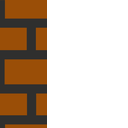

# Hi, I'm Trey 

I'm a full-stack developer who writes code to scratch my own itch. When something in the Nuxt ecosystem slows me down, at work or on a side project, I build the fix and share it.

- 🏠 Running a homelab that is absolutely more Kubernetes than one person needs
- 🤫 Building something top secret. That's all I can say for now
- ⚡ Powered by ADHD, which explains why this README is so long
- 🎮 Away from the keyboard I'm gaming, making music in Ableton, poking at 3D in Blender, or sketching whatever's in front of me
- 📺 Favorite shows: Avatar: The Last Airbender, Avatar: Seven Havens, and From on MGM+
- 📚 Currently reading the Empyrean series by Rebecca Yarros
- 🌱 Growing two orange trees, plus Carolina Reapers and jalapeños in two VIVOSUN grow boxes. The peppers become pepper jam
- 🐾 Ruled by one gecko and three cats: Gekky the gecko, Little Biscuit (Lil Biscuit for short, a long-haired Japanese Bobtail), Grimmy (aka Grims, Grimward, the Little Waste Management), and Niko the Cinnamon Swirl, because he's sweet and his coat looks like cinnamon

[](https://github.com/treygrr)
[](https://github.com/pulls?q=is%3Apr+author%3Atreygrr+is%3Amerged)

## 🔨 Things I've built

- 🛒 Frontends for massive e-commerce sites
- 🏢 Websites for businesses of all kinds, from power companies to nonprofits
- 🃏 An image classifier I trained myself that recognizes over 10,000 Pokémon cards with extremely high accuracy
- 🔌 Programmed USB controllers for servo gadgets, which power random things like 3D-printed CNC machines and automatic door closers
- 🍓 Plenty of Raspberry Pi projects, because I'm a Raspberry Pi enthusiast

**Stack I've worked with**

- **Web:** Vue, Nuxt, Quasar, React, Next.js, Ionic, Cordova
- **Backend:** Node, Bun, PHP, Laravel, ExpressionEngine, Craft CMS
- **Data:** Postgres, MySQL
- **Infra:** Docker, Docker Compose, Kubernetes (k3s)
- **Games & hardware:** C#, C++, Unity, Godot, Raspberry Pi

##  nuxt-airplane

Airplane mode for your GraphQL app. Typed composables from your `.gql` files, an IndexedDB cache, and a mutation queue that lands when you're back online.

[](https://www.npmjs.com/package/@treygrr/nuxt-airplane)
[](https://www.npmjs.com/package/@treygrr/nuxt-airplane)
[](https://treygrr.github.io/nuxt-airplane/)

[GitHub](https://github.com/treygrr/nuxt-airplane) · [Documentation](https://treygrr.github.io/nuxt-airplane/)

##  Nuxt modules

- 🔐 [nuxt-better-auth-ui](https://github.com/treygrr/nuxt-better-auth-ui). Sign-in, account, organization, and admin pages for Better Auth, built with Nuxt UI.
- 🔭 [nuxt-opentelemetry](https://github.com/treygrr/nuxt-opentelemetry). OpenTelemetry tracing for Nuxt servers, with request spans named after your Nuxt routes.
- 📧 [nuxt-generation-emails](https://github.com/treygrr/nuxt-generation-emails) (abandoned). Author, preview, and send transactional emails with MJML + Handlebars, with typed API routes for every template.

##  Vue

- 🎮 [playcanvas-vue](https://github.com/treygrr/playcanvas-vue). A Vue renderer for PlayCanvas: interactive 3D, written declaratively.
- ✉️ [vjml](https://github.com/treygrr/vjml) (abandoned). MJML-style email components for Vue, with typed exports and browser-side rendering.

##  More projects

<details>
<summary>GraphQL & Nuxt starters</summary>

- 🔌 [gql-modules](https://github.com/treygrr/gql-modules). Nuxt 3 + urql with SSR and GraphQL code generation, fully typed.
- 🚀 [nuxt-apollo-ts-graphql-gql-codegen](https://github.com/treygrr/nuxt-apollo-ts-graphql-gql-codegen). Nuxt 3 starter with Apollo, TypeScript, and GraphQL codegen.
- ⚛️ [next-apollo-typescript-tailwindcss](https://github.com/treygrr/next-apollo-typescript-tailwindcss). The same idea for Next.js, with Tailwind CSS.
- 🗄️ [Simple-Apollo-Server-TS-Postgresql-Docker-Prisma](https://github.com/treygrr/Simple-Apollo-Server-TS-Postgresql-Docker-Prisma). Apollo Server on PostgreSQL and Prisma, running in Docker.

</details>

<details>
<summary>Old School RuneScape tools</summary>

- 🤖 [rsb-ts](https://github.com/treygrr/rsb-ts). RSButler, a Discord bot for RuneScape and OSRS player stats and Grand Exchange prices.
- 📊 [osse](https://github.com/treygrr/osse). Tracks skilling progress for clan members.

</details>

<details>
<summary>Games & experiments</summary>

- 🏛️ [ruins](https://github.com/treygrr/ruins). A Godot game prototype.
- 🪐 [Orbital-Control](https://github.com/treygrr/Orbital-Control). A space maze game made in Unity.

</details>

<details>
<summary>Setup & tooling</summary>

- 🐳 [docker-lepp](https://github.com/treygrr/docker-lepp). Docker Compose stack for Laravel: PostgreSQL, pgAdmin, PHP, nginx, and Composer.
- 💧 [hyprland-liquid-glass-custom-changes](https://github.com/treygrr/hyprland-liquid-glass-custom-changes). My changes to hyprland-liquid-glass.

</details>

##  Contributions

I also contribute upstream, for example [nuxt-modules/better-auth](https://github.com/nuxt-modules/better-auth/pull/649) (fixed reading buffered bodies of in-process requests on Nitro 2).

[See my merged PRs](https://github.com/pulls?q=is%3Apr+author%3Atreygrr+is%3Amerged)

##  Tools

- 💻 [Code - OSS](https://github.com/microsoft/vscode), the open-source build of VS Code
- 🤖 [Claude Code](https://claude.com/claude-code)
- 🌐 [Chromium](https://www.chromium.org/)
- 🧪 [Nuxt DevTools](https://devtools.nuxt.com/)
- 📦 [pnpm](https://pnpm.io/) and [Node.js](https://nodejs.org/)
- 🐙 [GitHub CLI](https://cli.github.com/)
- 🐱 [kitty](https://sw.kovidgoyal.net/kitty/) for my terminal
- 🌙 [Noctalia](https://github.com/noctalia-dev/noctalia-shell) enthusiast. The best-looking shell on Wayland, no contest

##  Software I like

**Desktop, creative & gaming:** [ArtCraft](https://github.com/storytold/artcraft) · [Blender](https://www.blender.org/) · [Ableton Live](https://www.ableton.com/en/live/) · [Steam](https://store.steampowered.com/) · [Proton](https://github.com/ValveSoftware/Proton) · [Wine](https://www.winehq.org/) · [Docker](https://www.docker.com/)

**Homelab:** my homelab is a single-node GitOps cluster built on
[k3s](https://k3s.io/) ·
[Argo CD](https://argo-cd.readthedocs.io/) ·
[Kustomize](https://kustomize.io/) ·
[cert-manager](https://cert-manager.io/) + [Let's Encrypt](https://letsencrypt.org/) ·
[External Secrets](https://external-secrets.io/) + [Bitwarden Secrets Manager](https://bitwarden.com/products/secrets-manager/) ·
[Sealed Secrets](https://github.com/bitnami-labs/sealed-secrets) ·
[CloudNativePG](https://cloudnative-pg.io/) ·
[Cloudflare](https://www.cloudflare.com/) 🧡 (Tunnel + Access) ·
[Tailscale](https://tailscale.com/) ·
[Prometheus](https://prometheus.io/) ·
[Grafana](https://grafana.com/) ·
[Loki](https://grafana.com/oss/loki/) ·
[Tempo](https://grafana.com/oss/tempo/) ·
[Alloy](https://grafana.com/oss/alloy/)

##  fastfetch


```
           .-------------------------:                    trey@gaystation
          .+=========================.                    ---------------
         :++===++==================-       :++-           OS: CachyOS x86_64
        :*++====+++++=============-        .==:           Host: B650 AORUS ELITE AX ICE
       -*+++=====+***++==========:                        Kernel: Linux 7.3.0-5-cachyos
      =*++++========------------:                         Packages: 1230 (pacman), 15 (flatpak)
     =*+++++=====-                     ...                Shell: zsh 5.9.2
   .+*+++++=-===:                    .=+++=:              Display: 3440x1440 in 34", 240 Hz
  :++++=====-==:                     -*****+              WM: Hyprland 0.57.0 (Wayland)
 :++========-=.                      .=+**+.              Theme: adw-gtk3-dark [GTK], Fusion [Qt]
.+==========-.                          .                 Icons: breeze
 :+++++++====-                                .--==-.     Cursor: Bibata-Modern-Ice
  :++==========.                             :+++++++:    CPU: AMD Ryzen 9 7900X3D (24) @ 5.66 GHz
   .-===========.                            =*****+*+    GPU: NVIDIA GeForce RTX 5080
    .-===========:                           .+*****+:    Memory: 62.4 GiB   
      -=======++++:::::::::::::::::::::::::-:  .---:      Disk: 1.82 TiB (btrfs)
       :======++++====+++******************=.             
        :=====+++==========++++++++++++++*-               
         .====++==============++++++++++*-                
          .===+==================+++++++:                 
           .-=======================+++:                  
             ..........................                   
```
